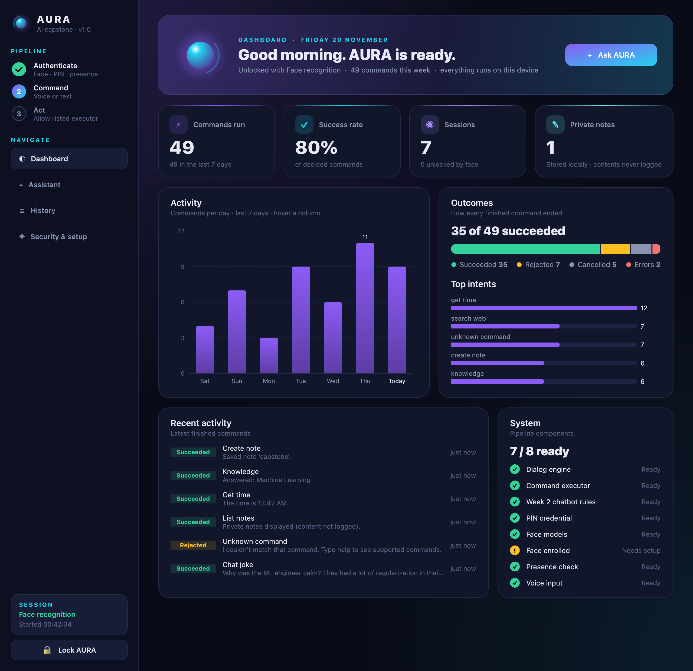
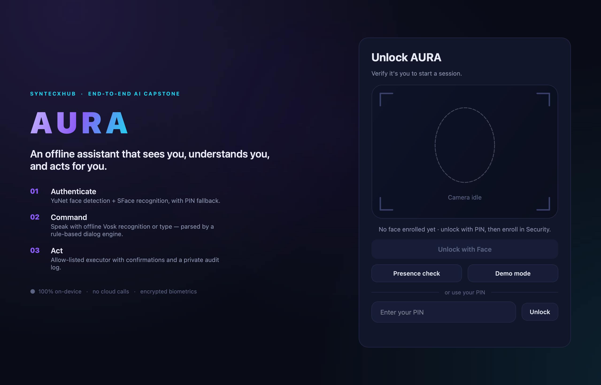
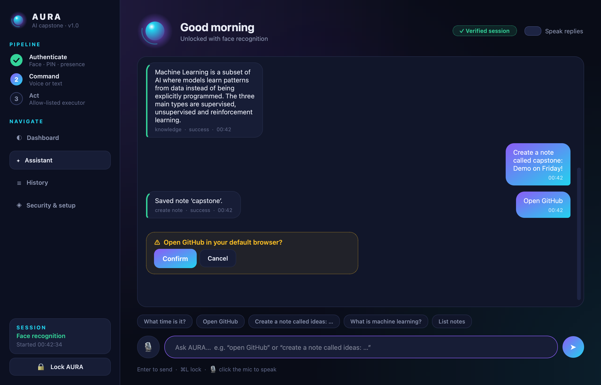
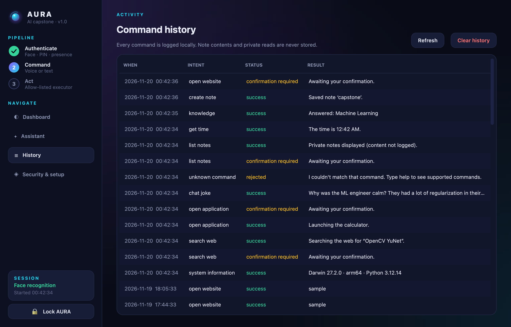
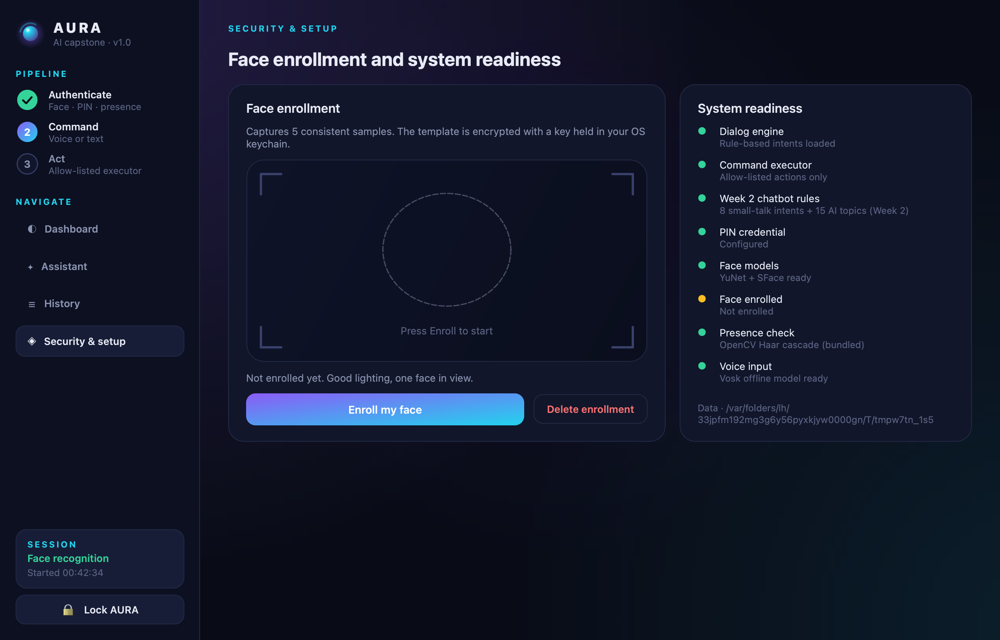
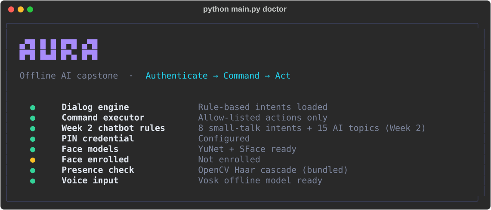
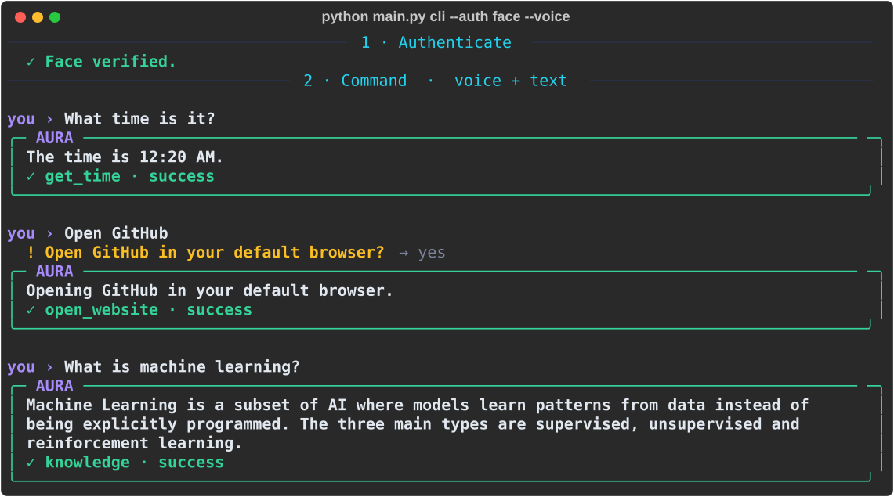
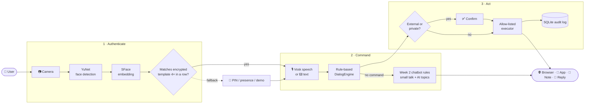

<div align="center">

# ✦ AURA

### Offline AI assistant: authenticate with your face, speak a command, watch it act.

**Syntecxhub AI Internship · Week 4 · Project 2: End-to-End AI Capstone**

<p>
  
  
  
</p>
<p>
  
  
  
  
  
</p>

<a href="#-quick-start"><b>Quick start</b></a> ·
<a href="#-screenshots"><b>Screenshots</b></a> ·
<a href="#-how-it-works"><b>How it works</b></a> ·
<a href="#-reuse-of-earlier-projects"><b>Reuse</b></a> ·
<a href="docs/DEMO_SCRIPT.md"><b>Demo script</b></a>

<br><br>



</div>

<br>

## 🌌 Overview

AURA combines three small AI components into **one pipeline** that runs entirely on your machine:

<table>
<tr>
<td width="33%" valign="top">

### 🧑‍💻 1 · Authenticate
**Face recognition.** YuNet finds exactly one face and SFace turns it into a 128-d embedding. The embedding must match your encrypted template on **4 frames in a row**.

Fallbacks: an Argon2 **PIN**, a zero-download **presence check**, or **demo mode**.

</td>
<td width="33%" valign="top">

### 🎙️ 2 · Command
**Speak or type.** Vosk transcribes speech offline. A **rule-based dialog engine** turns text into an intent with parameters.

*“Hey Aura, could you please open GitHub?”* → `open_website(github)`

</td>
<td width="33%" valign="top">

### ⚡ 3 · Act
**Allow-listed executor.** Opens approved sites, searches, launches apps, tells the time and keeps private notes.

It **asks before** anything leaves the app, and **logs** every action without private content.

</td>
</tr>
</table>

A single `Assistant` class drives **three front-ends**: the desktop app, the terminal app and a sandboxed scripted demo.

### ✨ The desktop app
- **Dashboard:** animated KPI tiles that count up, a 7-day activity chart, an outcomes bar, top intents and a live activity feed. Every bar has a hover tooltip.
- **Motion:** a drifting aurora background, cross-fading page transitions, chat bubbles that slide in, a “thinking” indicator, a state orb that pulses or ripples as AURA listens and works, and toast notifications.
- **Light on resources:** animations pause when AURA isn't the focused window. Set `AURA_REDUCED_MOTION=1` to turn transitions off.

---

## 📸 Screenshots

<p align="center"><br><b>Dashboard</b>: KPIs, activity, outcomes, top intents, live feed and system readiness</p>

<table>
<tr>
<td width="50%"><p align="center"><b>Lock screen</b>: face unlock, presence check, demo mode or PIN</p></td>
<td width="50%"><p align="center"><b>Assistant</b>: chat, live state orb, inline confirmations</p></td>
</tr>
<tr>
<td width="50%"><p align="center"><b>History</b>: local audit trail; note contents never stored</p></td>
<td width="50%"><p align="center"><b>Security &amp; setup</b>: face enrollment and readiness checklist</p></td>
</tr>
</table>

<details>
<summary><b>🖥️ Terminal app (click to expand)</b></summary>
<br>
<p align="center"></p>
<p align="center"></p>
</details>

> Screenshots are generated with `python scripts/capture_screenshots.py`. It renders each screen in a throwaway sandbox with no camera and no real data. The dashboard is seeded with a week of **sample** history so its charts have something to show.

---

## 🚀 Quick start

```bash
git clone https://github.com/yasmeenmh90-beep/Syntecxhub_AURA_AI_Capstone.git
cd Syntecxhub_AURA_AI_Capstone

python3.12 -m venv .venv && source .venv/bin/activate     # Windows: .venv\Scripts\activate
pip install -r requirements-dev.txt

python scripts/download_models.py   # optional: face (~38 MB) + voice (~40 MB) models into ./models
python main.py doctor               # check which components are ready
python main.py demo                 # 30-second scripted end-to-end run (safe dry run)
python main.py                      # launch the desktop app ✨
```

> 💡 **No models? No problem.** PIN unlock, presence check, demo mode and typed commands all work without any download. Platform notes are in [docs/INSTALLATION.md](docs/INSTALLATION.md).

### First run in the desktop app
| Step | What to do |
|:-:|---|
| 1 | Create a **PIN** (8+ characters) on the lock screen |
| 2 | **Security & setup → Enroll my face** (5 samples, good light, one face) |
| 3 | **Lock** (⌘L / Ctrl+L, or say “lock”) |
| 4 | **Unlock with Face**, then click 🎙 and say *“what time is it?”* |

### All entry points
| Command | What it does |
|---|---|
| `python main.py` | Desktop GUI (add `gui --speak` to read replies aloud) |
| `python main.py cli` | Terminal assistant; `--auth face\|pin\|presence\|demo`, `--voice`, `--speak` |
| `python main.py demo` | Sandboxed scripted demo; `--camera` for a live presence check, `--fast` for no pauses |
| `python main.py enroll` | Enroll your face from the terminal (PIN required) |
| `python main.py doctor` | Component readiness report |

---

## 🗣️ What you can say

| Say / type | Intent | Asks first? |
|---|---|:-:|
| hello · hey aura · good morning | `greeting` | |
| help · what can you do | `help` | |
| what time is it · tell me the time | `get_time` | |
| what day is it · today's date | `get_date` | |
| system info | `system_information` | |
| open / visit YouTube · Google · GitHub · Python | `open_website` | ✅ |
| search the web for … · google … | `search_web` | ✅ |
| launch the calculator · open text editor | `open_application` | ✅ |
| create a note called *title*: *body* | `create_note` | only to overwrite |
| read note *title* · list notes | `read_note` · `list_notes` | ✅ private |
| lock · lock my assistant | `lock_assistant` | |
| exit · quit aura | `exit_application` | ✅ |
| what is machine learning · explain RAG · tell me a joke | `knowledge` · `chat_*` *(Week 2 rules)* | |

Anything else is **rejected**. AURA never guesses at a request it doesn't recognise.

---

## 🧠 How it works



```
aura/
├── app.py                 entry point: gui · cli · demo · doctor · enroll
├── core/                  config · session state · Services (wiring) · Assistant (the pipeline)
├── authentication/        camera · YuNet/SFace detector · presence check · enrollment · verification · credentials
├── dialog/                intents · rule-based engine · smalltalk.py (Week 2 reuse) · data/
├── commands/              executor · URL/path validator · platform & dry-run adapters
├── voice/                 Vosk speech-to-text · text-to-speech
├── database/              SQLite repository (history, preferences, shortcuts)
├── ui/                    PySide6: theme · lock screen · main window · custom-painted widgets · workers
├── cli.py · demo.py       rich terminal app · scripted demo
scripts/                   download_models.py · capture_screenshots.py
docs/                      INSTALLATION · ARCHITECTURE · DEMO_SCRIPT · PROJECT_STATUS · screenshots/
tests/                     unit/ · integration/ · gui/
```

**Design rules:**
- No core module imports a UI. Frames and status go out through callbacks.
- `Services.build()` is the one composition root. To swap the camera, detector, browser adapter or keychain, pass a different object in.

Details and design decisions: [docs/ARCHITECTURE.md](docs/ARCHITECTURE.md).

---

## ♻️ Reuse of earlier projects

| Earlier project | Where it plugs in | Status |
|---|---|:-:|
| **Week 2 · Syntecxhub_Rule_Based_Chatbot** | `aura/dialog/smalltalk.py`, the fallback when no command matches | 🟢 **Integrated** |
| Week 3 · Syntecxhub_Face_Recognition | `Services.build(detector_factory=…)` (same YuNet + SFace stack) | 🔌 Plug-in point |
| Week 3 · Syntecxhub_Hand_Gesture_Recognition | second vision check or gesture-based confirmation | 🔌 Plug-in point |
| Week 4 · NOVA_Voice_Assistant | `SpeechRecognizer.listen()` / `Speaker.say()` | 🔌 Plug-in point |

How the Week 2 reuse works:
- Its `intents.json` and `knowledge_base.json` are copied **byte-for-byte** into `aura/dialog/data/`.
- Its matcher is ported rather than imported, because the original module loads its LLM client and UI on import.
- A **SHA-256-pinned test** fails if the copy ever drifts from the original.

Full reuse map: [docs/ARCHITECTURE.md#reuse-map](docs/ARCHITECTURE.md#reuse-map).

---

## 🔐 Security & privacy

| | |
|---|---|
| 🧬 **Biometrics** | Only embeddings are stored, never images. They are Fernet-encrypted with a key in the OS keychain, and the file is `0600`. |
| 🔑 **PIN** | Argon2id hash, 8–256 characters, exponential lockout after 5 failures |
| 🛡️ **Enrollment** | Changing it requires a verified session (PIN or face), never demo or presence |
| 🟡 **Low-assurance sessions** | Presence and demo unlocks are flagged amber in every UI |
| 🚦 **Executor** | HTTPS allow-list, no credentials or odd ports in URLs, `shell=False` launches from a fixed table, protection against path traversal and symlinks |
| 🙈 **Privacy** | Note bodies, private reads and search text never reach the log. Zero cloud calls. |

> ⚠️ **Known limitation:** there is no liveness detection, so a printed photo may pass face verification. A blink or head-turn challenge is the planned next step.

---

## 🧪 Testing

```bash
pytest          # 124 tests: unit · integration · GUI (pytest-qt, offscreen)
ruff check .    # lint
```

Fake cameras and detectors cover:
- enrollment, verification and rejection of a stranger
- timeouts and cancellation
- the presence check
- the full PIN → command → confirm → lock pipeline

The real ONNX and Vosk models are smoke-tested when they are present. The physical webcam and microphone are checked by hand using the rehearsal checklist in [docs/DEMO_SCRIPT.md](docs/DEMO_SCRIPT.md).

---

## 🛠️ Troubleshooting

| Problem | Fix |
|---|---|
| “Camera unavailable” | macOS: System Settings → Privacy & Security → Camera → allow your terminal/IDE. Or try `AURA_CAMERA_INDEX=1`. |
| “Face models missing” | `python scripts/download_models.py --face` |
| Mic button disabled | `python scripts/download_models.py --voice`, then allow microphone access |
| “Biometric encryption key is unavailable” | The keychain entry was removed. Delete the enrollment in Security and enroll again. |
| Want a clean slate | `AURA_DATA_DIR=/tmp/aura-test python main.py` |

Settings are environment variables: `AURA_DATA_DIR`, `AURA_MODEL_DIR`, `AURA_VOSK_MODEL`, `AURA_CAMERA_INDEX`, `AURA_REDUCED_MOTION` (see `.env.example`).

---

## 📚 Documentation

| Doc | Contents |
|---|---|
| [INSTALLATION.md](docs/INSTALLATION.md) | Requirements, models, OS permissions, data locations |
| [ARCHITECTURE.md](docs/ARCHITECTURE.md) | Module map, pipeline sequence, design decisions, reuse map |
| [DEMO_SCRIPT.md](docs/DEMO_SCRIPT.md) | 6-minute presenter walkthrough + hardware rehearsal checklist |
| [PROJECT_STATUS.md](docs/PROJECT_STATUS.md) | Brief requirements vs. delivery, bugs fixed, limitations |

---

<div align="center">

Built for the **Syntecxhub AI Internship** by [@yasmeenmh90-beep](https://github.com/yasmeenmh90-beep)

<sub>OpenCV Zoo models (YuNet, SFace) · Vosk by Alpha Cephei · Qt for Python · rich</sub>

</div>
